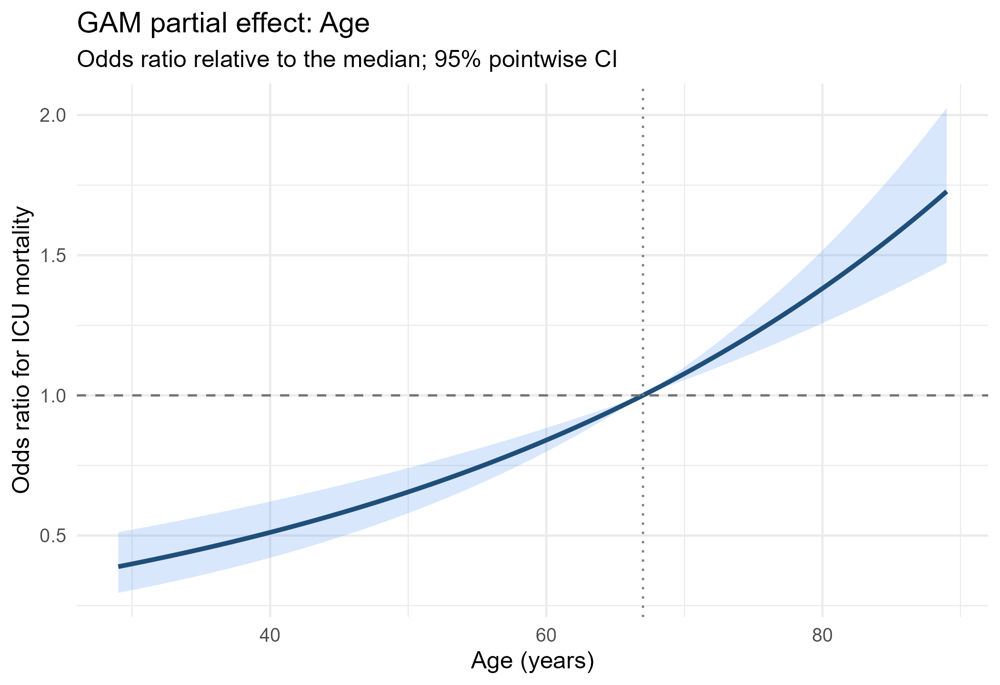

## AI-use statement

I used ChatGPT/Codex to develop and debug the evaluation code, organize the report, and draft the interpretation and README. The assistant executed the analysis using the supplied data and saved Checkpoint 2 model, checked file identity and prediction validity, and inspected the generated results. This statement does not claim that I independently repeated those checks. AI assistance made implementation and troubleshooting faster, but generated code required correction and numerical conclusions had to be checked against executed results. All reported numerical results are computed from the data; AI did not fabricate patient records or performance estimates. The analysis remains my responsibility as the submitting author.

```{r}
source('checkpoint3_analysis.R')
tab <- function(x,caption,digits=3) knitr::kable(x,caption=caption,digits=digits)
fig <- function(name) knitr::include_graphics(file.path('output',paste0('cp3_',name,'.png')))
```

## 3.1 Applying the frozen model to set-b and set-c

The question is whether the final model from Checkpoint 2 predicts in-hospital death in previously held-out intensive care unit (ICU) stays. The selected model is a **random forest**, fitted on all 4,000 set-a stays after comparison with ridge regression and a generalized additive model (GAM). This checkpoint loads that saved workflow without fitting or tuning it again. The two evaluation sets are held out from training, but they share the historical data source; they are not independent hospitals or prospective validation cohorts. Earlier exploratory versions of this assignment were run on these test sets, so this report should not be represented as a prospectively registered, first-ever look at their outcomes. The supplied model is kept unchanged.

`checkpoint3_features.R` contains the exact feature-building code extracted from the current Checkpoint 2 source. Checkpoint 3 calls this extracted function; the existing Checkpoint 2 source remains unchanged. Each stay has baseline age, recorded gender, height, weight and ICU type, plus first, last, minimum, maximum, mean and valid-observation count for time-varying measurements from hours 0–48. The sentinel −1 is missing, and nonpositive baseline height and weight are missing. Other extremes are retained as in training. Count-zero values distinguish absent measurements. The model's saved recipe supplies all learned exclusions, imputations, encodings and any transformations; nothing is estimated from test predictors. Inputs are explicitly put in training-recipe order. Record identifiers, outcomes, length of stay, survival and clinical severity scores are excluded from the model predictors.

The code checks 4,000 unique stays in each set, nonmissing binary outcomes, no overlapping record identifiers across sets, valid probabilities, and an unchanged model checksum before and after evaluation. All analyses use the same predictions.

```{r}
tab(cohorts,'Table 1. Evaluation cohorts, event rates and mean predicted risks',4)
```

Set-b contains **`r cohorts$Deaths[1]` deaths among `r cohorts$Stays[1]` stays** (`r fmt(100*cohorts$Death_rate[1],1)`%); set-c contains **`r cohorts$Deaths[2]` deaths among `r cohorts$Stays[2]` stays** (`r fmt(100*cohorts$Death_rate[2],1)`%). Comparing average risk with observed prevalence provides a first calibration check; it does not describe discrimination.

## 3.2 Discrimination

Area under the receiver operating characteristic curve (AUROC) measures how often a randomly selected death has a higher predicted risk than a randomly selected survivor. The 95% confidence intervals (CIs) below are percentile intervals from 2,000 stratified stay-level bootstrap resamples per method and set. The model is never refitted within these resamples. These intervals describe test-sample uncertainty conditional on the fitted model and the observed class counts; they omit training and model-selection uncertainty.

For comparison, the Simplified Acute Physiology Score I (SAPS-I) and Sequential Organ Failure Assessment (SOFA) scores are converted to probabilities with separate logistic mappings fitted only to set-a, following the Checkpoint 2 benchmark approach. Missing scores use set-a medians. These mappings are needed for decision curves, and monotone increasing mappings preserve score ranking. They are separate benchmarks and do not update the final forest.

```{r}
tab(comparison |> select(Model,Set,Mean_AUROC,SD_AUROC,AUROC,Lower,Upper),'Table 2. Checkpoint 2 five-fold CV mean and SD versus held-out AUROC and bootstrap 95% CI',4)
```

The random forest's cross-validation (CV) mean AUROC is **`r fmt(cv$Mean_AUROC[cv$Model=='Random Forest'],4)`**, with fold standard deviation **`r fmt(cv$SD_AUROC[cv$Model=='Random Forest'],4)`**. Its AUROC is **`r fmt(rf_perf$AUROC[1],4)`** on set-b and **`r fmt(rf_perf$AUROC[2],4)`** on set-c. The CV mean is `r if(all(cv$Mean_AUROC[cv$Model=='Random Forest']>rf_perf$AUROC)) 'higher than both test estimates, suggesting some optimism in the point estimates' else if(all(cv$Mean_AUROC[cv$Model=='Random Forest']<rf_perf$AUROC)) 'lower than both test estimates, so the observed test results do not indicate optimism' else 'between the two test estimates, so optimism is not consistent across sets'`. Fold SD is a description of variability across overlapping training splits, not a standard error or confidence interval for the CV mean. Selecting the winning model from those CV results can still introduce selection optimism.

The set-b minus set-c AUROC difference is **`r fmt(rf_perf$AUROC[1]-rf_perf$AUROC[2],4)`**, with an independent-cohort bootstrap 95% CI of **[`r fmt(delta_ci[1],4)`, `r fmt(delta_ci[2],4)`]**. Because this interval `r if(delta_ci[1]<=0 && delta_ci[2]>=0) 'includes zero, the observed difference is compatible with sampling variation' else 'excludes zero, the difference is larger than expected from this bootstrap sampling uncertainty alone'`. This is a direct interval for the difference, rather than a comparison of whether two separate intervals overlap.

```{r}
fig('roc')
```

**Figure 1.** The receiver operating characteristic (ROC) curves show the sensitivity/false-positive trade-off. Curves above the diagonal discriminate better than random ranking. Their proximity should be read alongside the difference interval above; neither curve establishes that the probabilities are calibrated.

```{r}
fig('precision_recall')
```

**Figure 2.** Set-b area under the precision-recall curve is **`r fmt(pr_auc)`**, compared with the no-skill prevalence baseline of **`r fmt(mean(b$death))`**. Deaths are a minority, so a classifier can appear accurate simply by predicting survival. Precision-recall analysis directly shows how many alerts identify deaths as sensitivity rises; the falling precision toward high recall makes the false-alert burden visible.

## 3.3 Calibration

Calibration-in-the-large (CITL) is the intercept from logistic regression with the logit of predicted probability as an **offset**. Its ideal value is zero; positive values mean average underprediction, negative values mean average overprediction. Calibration slope comes from a separate logistic regression with a free intercept and the predicted logit as a covariate. Its ideal value is one; below one indicates predictions that are too extreme, above one predictions that are too compressed. These regressions evaluate calibration and are not used to change any predictions. Probabilities are clipped to [0.000001, 0.999999] only when calculating logits.

The Brier score is the mean squared probability error; smaller is better. The scaled Brier score is `1 − Brier/[prevalence × (1 − prevalence)]`, using each test set's prevalence as a descriptive null benchmark. Zero matches that constant-risk benchmark and positive values improve on it.

```{r}
tab(calibration |> select(-Intercept_SE),'Table 3. Calibration and probability accuracy',4)
```

```{r results='asis'}
for(i in seq_len(nrow(calibration))) {
 z<-calibration[i,]
 cat(sprintf('In **%s**, CITL is **%.3f**, indicating average **%s**. The slope is **%.3f**, indicating **%s** predictions. Brier score is **%.4f**, and scaled Brier is **%.3f** (%.1f%% lower squared error than the prevalence-only benchmark).\n\n',z$Set,z$Intercept,if(z$Intercept>0)'underprediction' else 'overprediction',z$Slope,if(abs(z$Slope-1)<.05)'approximately ideal-spread' else if(z$Slope>1)'overly compressed' else 'overly extreme',z$Brier,z$Scaled_Brier,100*z$Scaled_Brier))
}
```

```{r}
fig('calibration')
```

**Figure 3.** Local linear loess with span 0.75 estimates the flexible observed-risk curve, with 95% pointwise percentile bands from 200 ordinary bootstrap resamples. Values are bounded to [0,1] for plotting. This is a smooth curve, not connected deciles. The bottom rug shows the density of predictions, making sparse high-risk regions visible. A curve above the diagonal indicates underprediction locally and one below indicates overprediction. Bands are pointwise, not simultaneous; uncertainty near the boundaries is substantial.

```{r}
tab(risk_regions,'Table 4. Descriptive risk-region counts and observed-minus-predicted gaps',3)
```

```{r results='asis'}
for(s in unique(risk_regions$Set)) {
 z<-risk_regions |> filter(Set==s,N>=50) |> arrange(desc(abs(Gap))) |> slice(1)
 cat(sprintf('For **%s**, the largest absolute gap among regions with at least 50 stays is in **%s**: observed mortality %.1f%% versus mean risk %.1f%% (N = %d), a %.1f percentage-point %s. This locates the main regional discrepancy; the smooth curve remains the primary calibration display.\n\n',s,z$Region,100*z$Observed,100*z$Predicted,z$N,100*abs(z$Gap),if(z$Gap>0)'underprediction' else 'overprediction'))
}
```

## 3.4 Clinical usefulness

The proposed use is an **additional clinician review at the end of the first 48 hours** for patients with predicted mortality risk at least **15%**, to prompt reassessment of clinical trajectory and communication needs. It is not an admission-time alert, treatment-withholding rule, or automatic goals-of-care decision. The 15% threshold is a fixed illustrative choice, not a threshold optimized on either test set. It implies that the benefit assigned to identifying one eventual death outweighs the cost of approximately 5.7 unnecessary reviews. Actual clinical preferences and review capacity have not been measured.

Decision curve analysis (DCA) reports net benefit, `TP/N − (FP/N) × threshold/(1 − threshold)`, from thresholds 5% to 50%. “Treat” here means flag for review. The curves compare the unchanged forest, the set-a-mapped SOFA benchmark, review everyone and review no one.

```{r}
fig('decision_curve')
```

**Figure 4.** At each threshold, the highest curve has the greatest net benefit under that threshold's assumed trade-off. Positive net benefit exceeds review-none; it does not establish that a particular intervention improves survival. The plotted range clips very negative review-all values to keep differences near zero readable; the CSV retains all values.

```{r}
tab(nb15,'Table 5. Net benefit at the fixed 15% review threshold',4)
tab(threshold_table,'Table 6. Operating characteristics and Challenge 2012 event 1 score at 15%',3)
```

The Challenge 2012 event 1 score is **min(sensitivity, positive predictive value)**. At 15%, set-b sensitivity is **`r fmt(threshold_table$Sensitivity[1])`**, positive predictive value (PPV) is **`r fmt(threshold_table$PPV[1])`**, and **`r fmt(threshold_table$Flagged_per_100[1],1)` patients per 100** are flagged; event 1 is **`r fmt(threshold_table$Event1[1])`**. Set-c results appear in the same table. PPV determines how many flagged stays actually end in death, while sensitivity quantifies missed deaths; neither should be replaced by overall accuracy.

At this threshold the forest `r if(all(nb15[['Random Forest']]>pmax(nb15$SOFA,nb15[['Treat all']],nb15[['Treat none']]))) 'has higher estimated net benefit than all three alternatives in both sets' else 'does not dominate every alternative in both sets'`. This is retrospective support for investigating a review workflow, not sufficient evidence to implement it. Calibration errors near the action threshold, review burden and intervention effects require prospective evaluation.

## 3.5 Subgroups on set-b

The prespecified descriptive groupings are age ≤50, 51–65, 66–80 and >80; recorded female/male gender; and the four recorded ICU types. Missing categories are retained. AUROC intervals use 1,000 stratified bootstrap resamples within each group. CITL intervals are Wald intervals from the offset model. Estimates are suppressed when a group has fewer than 10 deaths or survivors. All stay and death counts remain visible.

```{r}
tab(subgroups,'Table 7. Set-b subgroup discrimination and calibration-in-the-large',3)
fig('subgroups')
```

**Figure 5 and Table 7.** The intervals show why small subgroups should not be ranked solely by point estimates. CITL provides a separate check: a group can rank patients well while systematically over- or underpredicting their risks.

```{r results='asis'}
for(v in unique(subgroups$Variable)) {
 z<-filter(subgroups,Variable==v,is.finite(AUROC));lo<-z[which.min(z$AUROC),];hi<-z[which.max(z$AUROC),]
 cat(sprintf('For **%s**, AUROC ranges from %.3f in %s (N = %d, deaths = %d) to %.3f in %s (N = %d, deaths = %d), a gap of %.3f. %s\n\n',v,lo$AUROC,lo$Group,lo$N,lo$Deaths,hi$AUROC,hi$Group,hi$N,hi$Deaths,hi$AUROC-lo$AUROC,if(hi$AUROC-lo$AUROC>=.05)'This exceeds an illustrative 0.05 discrimination difference and is large enough to motivate follow-up.' else 'This is below an illustrative 0.05 discrimination difference and is less compelling on magnitude alone.'))
}
z<-subgroups |> filter(is.finite(CITL)) |> arrange(desc(abs(CITL))) |> slice(1)
cat(sprintf('The largest absolute CITL is %.3f for **%s**, suggesting %s for that group. This potential calibration difference matters for a common risk threshold, even if AUROC remains adequate.\n\n',z$CITL,z$Group,if(z$CITL>0)'underprediction' else 'overprediction'))
```

The 0.05 difference is an explicit descriptive yardstick, not a validated clinical minimum or a hypothesis-test cutoff. Age, sex and ICU analyses involve multiple, overlapping comparisons and unadjusted intervals. Case mix, measurement practices and differing event counts can explain apparent gaps; these results cannot establish inequitable treatment or a reproducible subgroup effect without further validation.

## 3.6 Interpretation

```{r}
fig('importance')
tab(head(importance,15),'Table 8. Largest set-a permutation importances in the frozen forest',5)
```

**Figure 6 and Table 8.** The strongest global predictors include **`r paste(head(importance$Predictor,5),collapse=', ')`**. The importance values are the saved forest's training-stage permutation importances, not a refit on test outcomes. They measure how model prediction error changes when a variable is disrupted. Correlated summaries can share or mask importance, so the ranking is not a list of independent biological effects. GCS denotes Glasgow Coma Scale, BUN blood urea nitrogen, and HR heart rate.

```{r}
fig('age_pdp')

```

**Figures 7–8.** The forest age partial dependence plot (PDP) averages predictions over 400 fixed set-a background stays while changing age from 20 to 90. Age was selected because it is clinically interpretable and has a corresponding Checkpoint 2 Model 2 curve. The second figure is the actual saved Checkpoint 2 GAM age curve, reused without refitting. Its vertical label says ICU mortality, but the modeled endpoint in both checkpoints is **in-hospital death**.

The forest's average risk changes from **`r fmt(pdp$Risk[which.min(abs(pdp$Age-30))])` at age 30** to **`r fmt(pdp$Risk[which.min(abs(pdp$Age-80))])` at age 80**. It is comparatively flat through younger ages and rises more sharply in older patients. The GAM shows a smooth increasing odds ratio relative to median age, with wider uncertainty toward the extremes. Both associate older age with higher risk, but the forest concentrates more of the increase at older ages. These figures compare direction and shape, not numerical effect size: the forest axis is marginal average probability, while the GAM axis is a conditional odds ratio. The PDP may create uncommon age/physiology combinations and is descriptive rather than causal.

Important predictors should not be interpreted as interventions. For example, **GCS measurements can reflect sedation or ventilation as well as neurologic status**, and measurement counts reflect clinical concern and monitoring intensity. Changing a GCS value or ordering fewer tests would not necessarily change mortality as the model implies. Treatment may be a response to severity, and effective treatment may allow a patient with very abnormal early measurements to survive. Unmeasured diagnoses, treatment decisions and care limitations can confound these associations.

## 3.7 Most confident mistakes on set-b

I select the five survivors with the highest predicted risks and the five deaths with the lowest predicted risks, regardless of the review threshold. Ties are broken by ascending RecordID; the lowest-risk deaths shown here share a predicted probability of zero, which is a forest output and does not establish that death was impossible. This is post-hoc error inspection and does not change the model. For each case, I examine raw missingness, selected extreme-value flags, and local sensitivity among the 30 most globally important transformed predictors.

For local sensitivity, one predictor is replaced by values from 50 fixed set-a donors, leaving all other predictors fixed. The reported contribution is original risk minus the mean donor-replaced risk. A positive value indicates that the patient's value supports higher predicted risk; a negative value supports lower risk. These are **donor-replacement sensitivity values, not SHAP values or an additive risk decomposition**. They can be affected by correlation and unrealistic replacement combinations. Values displayed are after the frozen recipe's processing; missingness is measured before imputation.

```{r}
tab(case_report |> select(RecordID,Case,Observed,Risk,Age,Missing_fraction),'Table 9. Five highest-risk survivors and five lowest-risk deaths',3)
```

The two groups expose opposite weaknesses: high predicted severity does not preclude recovery, while reassuring first-48-hour summaries do not rule out subsequent death. The following case-specific assessments distinguish observed data flags from hypotheses that cannot be verified with these tables.

```{r results='asis'}
for(i in seq_len(nrow(case_report))) {
 z<-case_report[i,]
 cat(sprintf('### Record %s: %s\n\nPredicted risk: **%.1f%%**; observed death: **%d**; missing predictor summaries: **%.1f%%**.\n\n**Predictors supporting the prediction:** %s. Parentheses give signed probability changes under donor replacement.\n\n**Data check:** %s. These flags are screening indicators, not confirmed erroneous observations; correlated summaries can repeat the same missing measurement.\n\n**Judgment:** %s\n\n',z$RecordID,z$Case,100*z$Risk,z$Observed,100*z$Missing_fraction,z$Drivers,z$Data_flags,z$Judgment))
}
```

```{r}
fig('local_errors')
```

**Figure 9.** Each panel shows the five largest absolute local sensitivities among the 30 inspected predictors for that record. Positive bars support higher risk and negative bars lower risk. These panels explain the model's dependence on recorded values; they cannot determine the clinical cause of survival or death. Chart review and subsequent clinical events would be needed to distinguish preventable model error from omitted information and irreducible outcome variability.

## 3.8 Conclusions and limitations

The frozen forest achieves AUROCs of **`r fmt(rf_perf$AUROC[1])` and `r fmt(rf_perf$AUROC[2])`** on set-b and set-c, respectively. These results support useful risk ranking within this data source. Calibration and decision-curve results add information that AUROC alone misses, and the confident errors demonstrate that individual predictions remain uncertain.

**Clinical recommendation.** I would not recommend deploying the proposed 15% review alert directly from this analysis. Its retrospective net benefit and operating characteristics justify a prospective, clinician-supervised evaluation, but false alerts consume review capacity, some deaths are missed, and calibrated risks are essential near the decision threshold. A silent prospective evaluation should assess calibration, subgroup performance and review workload before an impact study tests whether the workflow improves communication or care. The model should never determine withdrawal or limitation of treatment.

**Limitations.** All sets come from one historical source, limiting transportability to other hospitals and current practice. The 48-hour window means this is not an admission prediction, and the historical cohort does not establish a clean prospective 48-hour landmark population restricted to people still alive and eligible for review. Summaries lose timing, slopes and treatment response. Diagnosis, comorbidities, medication context, subsequent deterioration, goals of care and many social factors are absent. Missingness is informative and may shift with clinical practice; imputation does not recover unobserved physiology. Extreme measurements were retained to match training. Multiple summaries of the same measurement are correlated. Bootstrap intervals omit training and model-selection uncertainty, DCA has no intervention-specific outcome evidence, and subgroup and error analyses are exploratory. Prior exposure to these test sets limits claims of completely untouched confirmatory validation even though the model remains fixed.

**Leakage risk and prevention.** Leakage could enter through outcome-derived predictors, measurements after the allowed time window, duplicated stays across splits, full-data imputation, test-driven model or threshold selection, or recalibration on test outcomes. The matching feature builder restricts measurements to 0–48 hours, excludes outcomes and benchmark scores from model inputs, checks identifiers, and applies the saved set-a preprocessing. The final model is loaded unchanged, the 15% action threshold is fixed for this report, and diagnostic test-set calibration regressions are never fed back into predictions. SOFA and SAPS-I risk mappings use set-a only. Distinct stay identifiers do not prove distinct people if repeat admissions cannot be linked, and within-window care near early deaths remains a temporal limitation. Selecting the model using set-a CV also introduces selection uncertainty that is not eliminated by frozen evaluation.

**Causal interpretation.** None of the important predictors is interpreted as a causal effect. Age, GCS, laboratory summaries and monitoring counts help predict outcomes under observed care; manipulating them is not equivalent to changing patient prognosis. Associations influenced by sedation, monitoring intensity or treatment response are particularly unsuitable for causal claims.

## Reproducibility and session information

The report, tables and figures are generated by `pixi run --locked checkpoint3`. The task reads raw inputs from `data/` and the previously saved Checkpoint 2 artifacts from `output/`; all new analysis artifacts are written under `output/`. Reading the existing model and comparison files is necessary to satisfy the requirement to evaluate the saved model rather than refit it. Seeds, bootstrap counts and the decision threshold are fixed in the source. The model MD5 checksum is **`r model_md5`**. This analysis took **`r fmt(runtime,2)` minutes**, excluding environment installation and final HTML packaging.

```{r}
required<-c('cp3_predictions.csv','cp3_discrimination.csv','cp3_calibration.png','cp3_decision_curve.png','cp3_subgroups.csv','cp3_age_pdp.png','cp3_confident_errors.csv')
stopifnot(all(file.exists(file.path('output',required))))
```

::: {.callout-note collapse="true" title="Session Info"}
```{r}
sessionInfo()
```
:::
